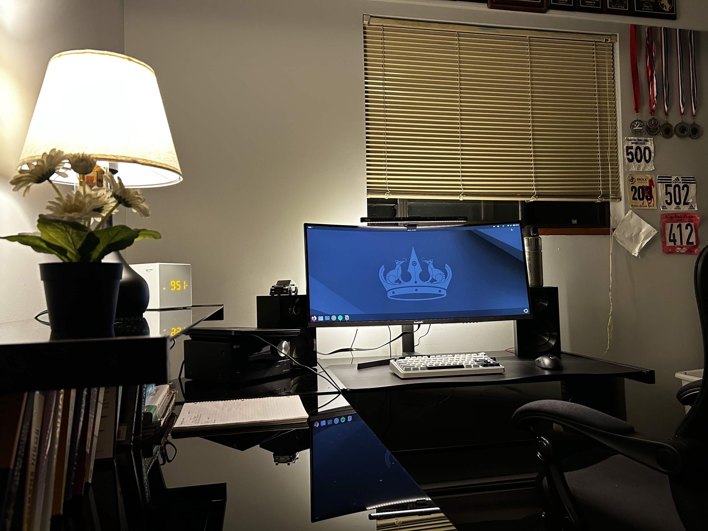
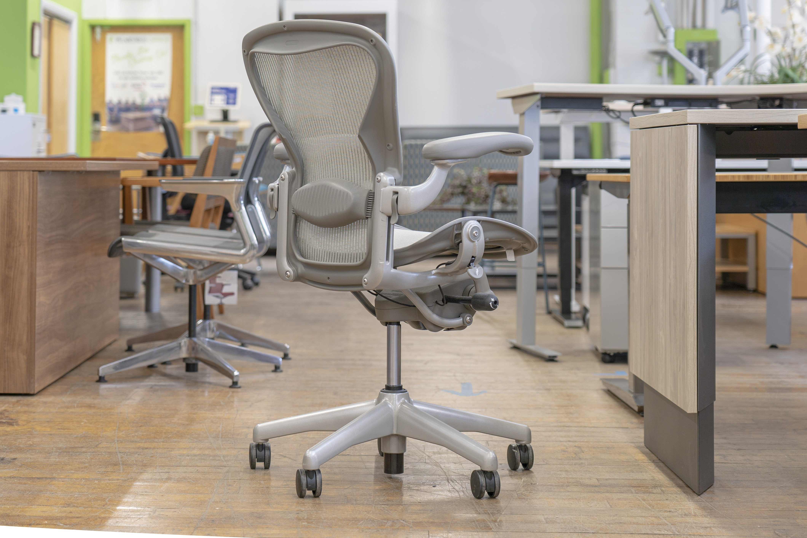
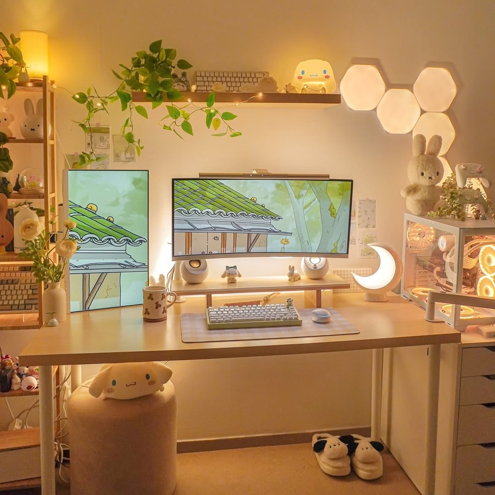
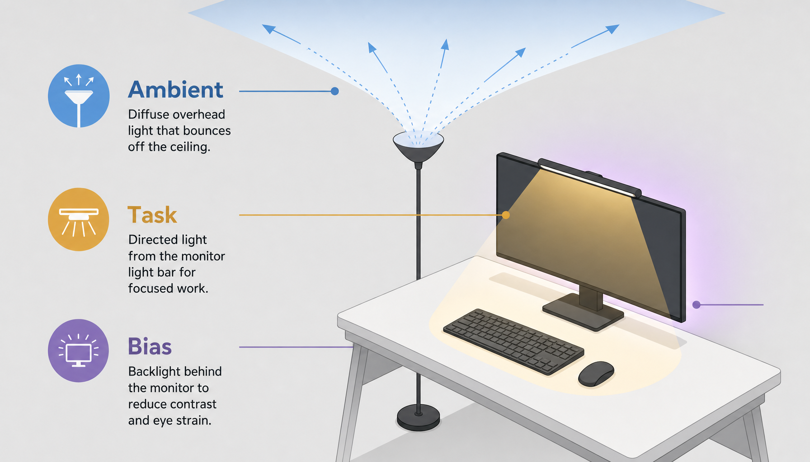
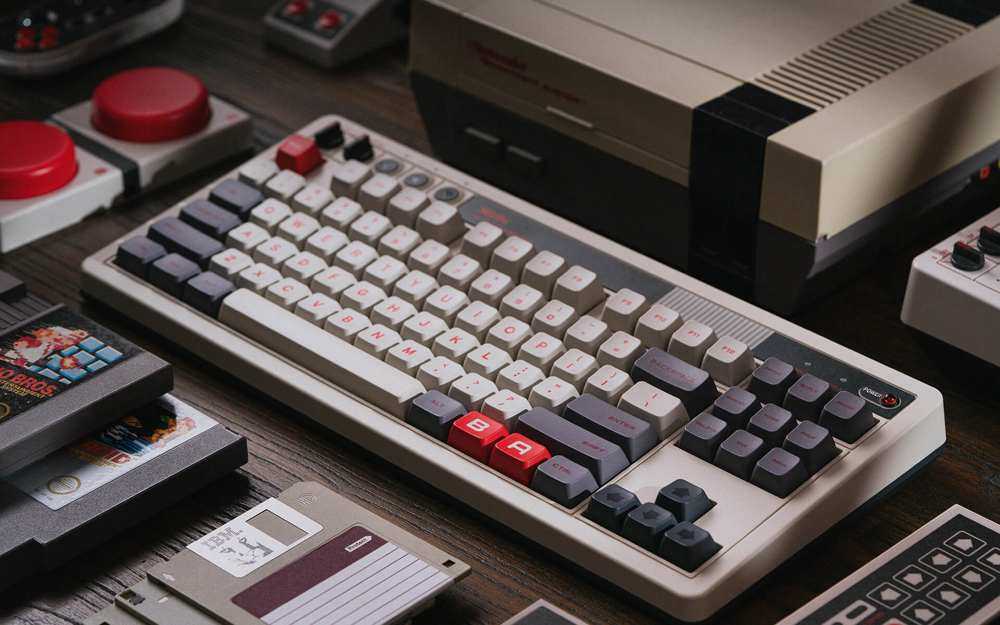
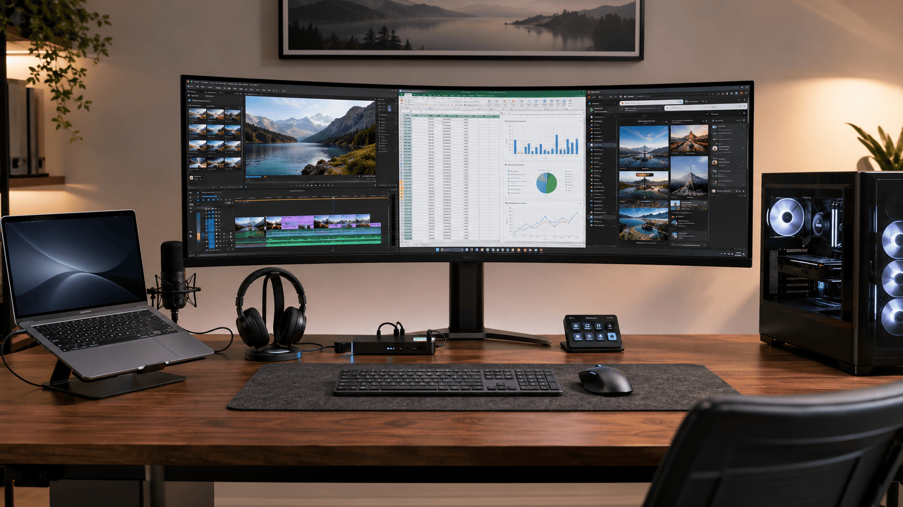

## Introduction
As software developers we spend a lot of time at our desks. It's our interface to the digital world. A place where
we learn, build, and play. My old setup was very simple: I had my laptop, a wireless mouse my friend gave me, and
an old chair that I got for free. While it was completely sufficient, I started to think about how I could
improve my space to support my journey as a developer. I wanted to improve the comfort of my space, and invest
in the tools I use on a daily basis.  

## S-Tier Upgrades
I spent days looking at my old setup and thinking about what upgrades would give me the most benefit for least cost.
I watched videos on YouTube just to learn that there's no end to how much money you can spend to improve your setup. 

Therefore, I'm making a short list of my favourite workspace upgrades so that you can improve your programming
experience for minimal cost.

### Chair

A comfortable chair is the number one area for improvement. Staying in a static position for
long periods of time can be hard on the body. Your chair is the biggest point of contact you have with your workspace.
It's important for both comfort and longevity.  
**When choosing a chair look for something that gives you adjustability because everyone's body is different.**

### Lighting

Lighting heavily influences how your setup feels (I'm a huge fan of warm cozy lighting). 
You can also adjust it to reduce eye strain by minimizing both screen glare and sharp contrasts between light and dark.  

**It's an inexpensive upgrade that can make a world of difference.**

#### Layered Lighting
Instead of relying on a single light for everything, multiple light sources can be deployed with their own roles.
This gives you greater flexibility to adjust your lighting setup.

#### Ambient Lighting
Ambient lighting floods the space with a base layer of light. I like to use lamps for this. Lamps are also 
really nice for relaxing or reading.

#### Task Lighting
Task lighting illuminates your desk. This is useful if you are writing notes or reading books.
It's also good for creating more uniform lighting between your monitor and desk. 

#### Bias Lighting
Bias lighting is super important for improving viewing comfort. It creates more uniform lighting between your 
monitor and the wall behind it. For this I just use a cheap LED strip on the back of my monitor.

### Mechanical Keyboard

I was skeptical of getting a mechanical keyboard because almost all keyboards can get the job done. However, it's become
one my favourite upgrades ever. If you don't already use a mechanical keyboard, just imagine each keystroke
being really satisfying. It's a completely subjective upgrade but somehow completely worth it.

A nice mechanical keyboard can be pretty inexpensive if you get a wired one. And if you have a laptop, it's nice to
be able to position your keyboard separately from your monitor.  

Linear switches are my favourite, and they aren't too loud.

### Water Bottle

A lot of the time I enter flow state while working and completely forget to drink water.
Debugging doesn't have to leave you dehydrated.
This may seem like a silly upgrade but it's important!  

My recommendations for a workspace water bottle:
- High capacity so that you always have water available throughout the day
- A sealed lid to prevent accidents
- Stainless steel or glass material to prevent chemical leeching and odors
- A straw so that you can drink water without your hands leaving the home row

## Honourable Mentions
### Monitor Setup 

Monitors create your visual gateway into the digital world. 
Extra screen space makes it easier to refer to resources while coding.
It also enables you to use larger fonts which makes reading and writing easier. And as developers, we do
a lot of reading and writing.  

I personally prefer using a single ultra wide monitor because it feels really immersive. Multiple monitors
can be really good too if positioned well and if the colour is consistent across monitors.

### Noise Cancelling Headphones

Noise cancelling headphones are good for entering flow state and minimizing distractions. Coding becomes more
immersive, and the sounds in your environment stop competing with your thinking.

The first time I tried noise cancelling headphones, 
it felt like I was in my own auditory bubble. An introvert's dream.  

However, the value of noise cancelling headphones depends on how noisy your space is. 
And there are cheaper alternatives such as earplugs, earmuffs, or passive noise isolation.

## Conclusion
If you have made it this far thank you for reading. Upgrading your workspace is one of the best investments 
you can make if you spend a lot of time at your desk. Hopefully my insights help you identify ways to improve
your setup significantly without having to spend loads of money.
